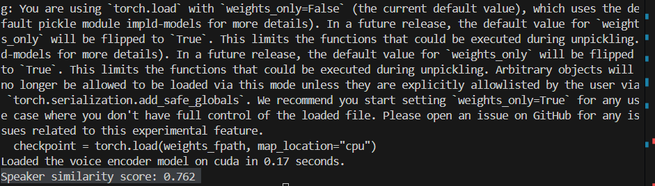

# Persona TTS — Phase 1
**Data-Centric Speaker Conditioning with XTTS**

## Final Result

**Speaker similarity score:** **0.762** (cosine similarity)

Measured between real voice and generated speech using a pretrained speaker verification model ([Resemblyzer](https://github.com/resemble-ai/Resemblyzer)).

Moderate-to-strong speaker identity alignment without any model training — multi-reference conditioning only.



## Overview

Phase 1 explores **speaker conditioning** with XTTS under limited voice data.

No model training or fine-tuning. The question is how far voice similarity can be pushed with **data selection, reference composition, and objective evaluation** alone.

## Objectives

- Study voice cloning without training
- Improve speaker identity via reference audio selection
- Build a clean conditioning pipeline
- Evaluate similarity objectively (not listening alone)

## Repository Structure

```
persona-tts/
├── scripts/           # ASCS + automatic reference bucketing
│   ├── ascs.py
│   └── auto_bucket.py
├── inference/         # XTTS conditioning / generation
│   ├── conditioning.py
│   └── xtts_test.py
├── evaluation/        # Speaker verification scoring
│   └── speaker_verification.py
├── docs/              # Pipeline stage notes
├── assets/
└── README.md
```

Audio data and generated outputs are excluded for privacy (see `.gitignore`).

## Pipeline

```
Recording
  → Preprocessing
  → Segmentation
  → Clip Selection (ASCS)
  → Reference Bucketing
  → Multi-Reference Conditioning
  → Speaker Verification
```

Stage writeups: [preprocessing](docs/01_preprocessing.md) · [processing](docs/02_processing) · [inference](docs/03_inference) · [evaluation](docs/04_evaluation)

## Key Components

### Adaptive Speaker Clip Selection (ASCS)

`scripts/ascs.py` ranks clips by duration, RMS energy, and silence ratio. Low-quality clips are dropped to stabilize speaker embeddings.

### Automatic Reference Bucketing

`scripts/auto_bucket.py` groups clips into approximate styles (neutral, expressive, energetic, slow) for controlled conditioning experiments.

### Conditioning-Based Inference

XTTS v2 in **reference conditioning mode** only:

- no weight updates
- no fine-tuning
- no dataset training

Speaker identity is injected via multiple reference clips (`inference/conditioning.py`).

### Objective Evaluation

`evaluation/speaker_verification.py` extracts embeddings and reports cosine similarity between real and generated speech.

## Observations

**Worked well**
- multi-reference conditioning
- clean short reference clips
- data quality over quantity
- objective verification aligned with perception

**Did not**
- long-form stability
- emotional expressiveness
- full identity consistency

## Limitations

- no model training / gradient updates
- identity drift in long narration
- limited expressive control

Expected for conditioning-only approaches.

## Future Scope

Phase 2 (Linux): training-based adaptation — gradient speaker adaptation, alignment-aware learning, paper-oriented evaluation.

Phase 1 is the foundation.
